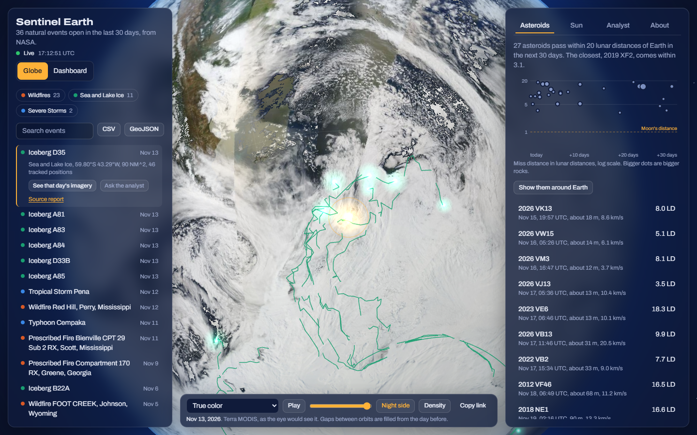
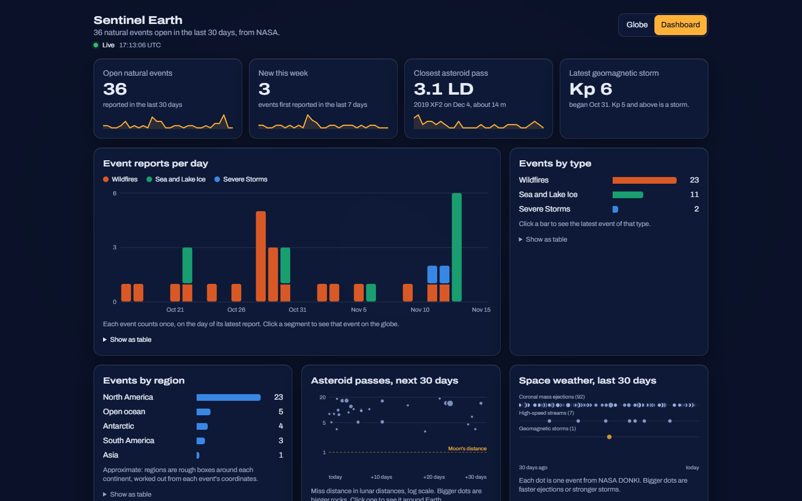
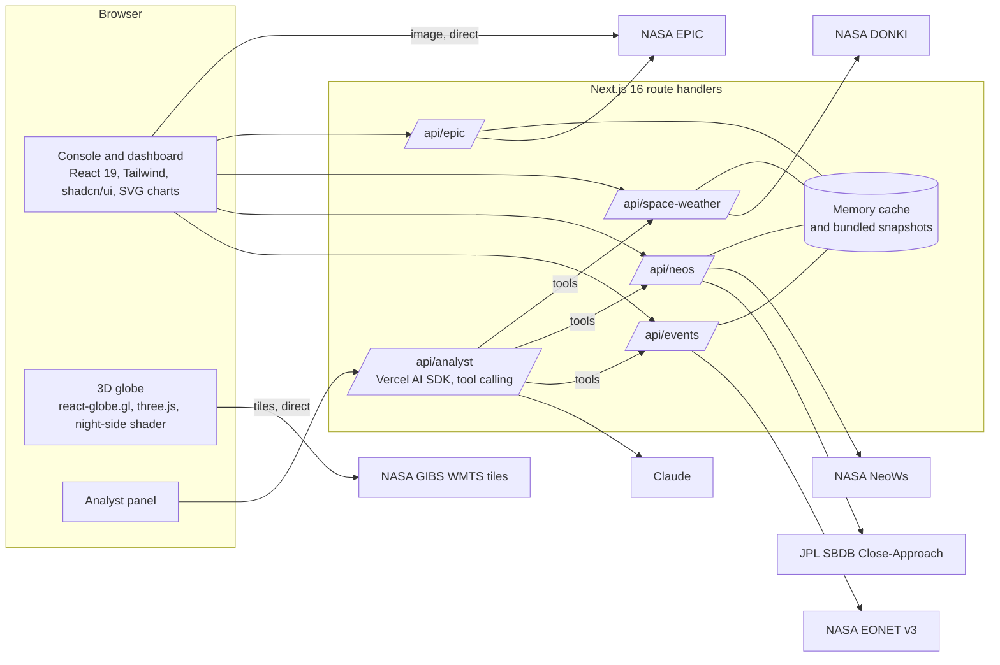

# Sentinel Earth

Live NASA data on fires, storms, space weather and passing asteroids, on one 3D globe and one dashboard, with an AI analyst that answers questions from the same feeds.

Built for the NASA Space Apps Challenge 2026.





## The problem

NASA publishes what is happening to the planet through many separate services: one for natural events, one for satellite imagery, others for near-Earth objects and space weather. A disaster analyst who wants to see a wildfire, the satellite pass that imaged it and how it developed over the past weeks has to work across several tools and formats.

Sentinel Earth joins six of those services in one place:

- **Natural events.** Every open event from NASA EONET for the last 30 days, on the globe and in a list you can search and filter. Moving events such as storms and icebergs show their track. Newer reports draw larger, and events from the last 48 hours pulse.
- **Satellite imagery over time.** Five NASA GIBS layers (true color, fire and burn scars, sea surface temperature, city lights, Blue Marble) with a 30-day date slider and playback.
- **A globe that shows the real moment.** The day side is lit from where the sun is right now, the night side shows NASA's Black Marble city lights, and open ocean catches the sun's glint. Gaps between satellite passes are filled from the day before, with Blue Marble underneath. Events glow as beacons, storm and iceberg tracks flow in their direction of travel, and a density layer shows where events cluster.
- **Dashboard.** Key numbers, event reports per day, breakdowns by type and region, the asteroid timeline, space weather, today's picture of Earth and the freshness of every source. Every chart has a table view, and clicking a mark opens that event or asteroid on the globe.
- **Space weather.** Coronal mass ejections, geomagnetic storms, high-speed solar wind streams and solar flares from NASA DONKI for the last 30 days.
- **Earth today.** The latest full-disk photograph from the DSCOVR EPIC camera.
- **Asteroid passes.** Every object passing within 0.05 AU in the next 30 days from JPL, charted by date and miss distance and shown around Earth.
- **Analyst.** Ask a question in plain language. Claude queries the same feeds through tools, and every event it cites becomes a button that flies the globe there.
- **Export and share.** Download the listed events as CSV or GeoJSON. The address always holds the view, layer, date and selected event, so a briefing can open on an exact view.

## Who it is for

NASA Earth Applied Sciences and Disasters program staff, the emergency managers they support, and anyone briefing non-specialists.

## Challenge alignment

> **To fill in before submitting.** The official 2026 challenge list could not be read automatically while this was built. Pick the challenge on <https://www.spaceappschallenge.org/2026/challenges/> that best matches Earth observation, disasters or open-data visualization, and name it here.

## Architecture



- The server normalises each feed into a small typed shape ([src/lib/nasa.ts](src/lib/nasa.ts)) and caches it in memory (events 10 minutes, space weather 30 minutes, asteroids and EPIC 1 hour).
- If a NASA service fails, the server returns its last good answer, or the snapshot bundled in [src/data](src/data), and marks it as saved data. The interface and the dashboard's freshness table say so. The demo never shows an empty screen.
- The NASA API key is used only on the server. Imagery tiles and the EPIC photograph load in the browser from hosts that need no key.
- The night side is one shader on a shell above the globe. It reads the sun's position from the clock and blends in a Black Marble texture bundled in [public/night.jpg](public/night.jpg).
- The analyst has three tools, `get_natural_events`, `get_close_approaches` and `get_space_weather`, which read the same cached feeds as the interface. It is told to answer only from tool results and to cite event ids.
- Event colours follow one fixed palette, checked for colour-blind separation and contrast against the panel background.

## Data sources

| Source | Used for |
| --- | --- |
| [NASA EONET v3](https://eonet.gsfc.nasa.gov/docs/v3) | Open natural events, positions, tracks, magnitudes |
| [NASA GIBS](https://www.earthdata.nasa.gov/engage/open-data-services-software/earthdata-developer-portal/gibs-api) | Daily imagery: MODIS Terra true color and bands 7-2-1, GHRSST sea surface temperature, VIIRS Black Marble, Blue Marble |
| [NASA DONKI](https://ccmc.gsfc.nasa.gov/tools/DONKI/) | Space weather: coronal mass ejections, geomagnetic storms, high-speed streams, solar flares |
| [NASA EPIC](https://epic.gsfc.nasa.gov/) | Latest full-disk photograph of Earth from DSCOVR |
| [JPL SBDB Close-Approach API](https://ssd-api.jpl.nasa.gov/doc/cad.html) | Asteroid pass dates, distances, speeds, brightness |
| [NASA NeoWs](https://api.nasa.gov/) | Catalogued asteroid sizes and the potentially-hazardous flag |

## Setup

Needs Node.js 22.18 or newer.

```bash
npm install
cp .env.example .env.local   # then fill in the keys
npm run dev                  # http://localhost:3000
```

| Variable | Needed | Purpose |
| --- | --- | --- |
| `NASA_API_KEY` | Recommended | Free from <https://api.nasa.gov>. Used for DONKI, EPIC and NeoWs. Without it the app uses the shared `DEMO_KEY`, which is limited to about 30 requests an hour. |
| `ANTHROPIC_API_KEY` | For the analyst | Without it the analyst panel reports that it is offline; everything else works. |
| `ANALYST_MODEL` | Optional | Defaults to `claude-opus-5-5`. |

### Checks

```bash
npm run selfcheck            # logic: sun position, regions, CSV and GeoJSON export
npm run build
npx next start -p 3001       # on Windows, scripts/restart.ps1 rebuilds and restarts it
npm run verify               # in a second terminal
```

`npm run verify` drives the app in Microsoft Edge at 1440px and 375px. It selects an event, searches, downloads both exports, opens every tab and the dashboard, waits for the EPIC photograph, saves screenshots to [docs/screenshots](docs/screenshots) and fails on any console error or failed request. Set `BROWSER_CHANNEL=chrome` to use Chrome. Set `ANTHROPIC_CHECK=1` to also wait for a live analyst answer.

### Deploy

```bash
npx vercel --prod
```

Add `NASA_API_KEY` and `ANTHROPIC_API_KEY` in the Vercel project settings first. The analyst route has no rate limit, so anyone with the URL can spend your API credits; add a limit before sharing the link widely.

## Two-minute demo script

1. **0:00 Open the app.** The camera falls in from deep space onto today's Terra imagery, daylit side first. Drag the globe to the night side: "That line is where the sun is setting right now, and those are real city lights." "Everything here is live NASA data. Nothing is mocked."
2. **0:15 Events.** Turn Wildfires off and on. Type "Iceberg" in the search box. Click a storm: the globe flies there and shows its track. Pulsing markers are reports from the last 48 hours.
3. **0:35 Imagery over time.** Click "See that day's imagery". Switch the layer to "Fire and burn scars" on a wildfire. Press Play and let a few days run. Turn on Density to show where events cluster.
4. **0:50 Dashboard.** Switch to Dashboard. Read the four key numbers. Hover the reports chart, open "Show as table" once, point at today's EPIC photograph and the freshness table. Click a bar: it lands back on the globe at that event.
5. **1:10 Space weather.** Open the Sun tab. "Ninety-odd solar eruptions and one geomagnetic storm this month, from NASA's DONKI."
6. **1:20 Asteroids.** Open the Asteroids tab. Read the closest pass against the Moon's distance line. Click "Show them around Earth".
7. **1:35 Analyst.** Ask: "Which active wildfires are near populated areas this week?" Click a citation in the answer and the globe flies to it. "The model can only answer from the feeds, and it shows its sources."
8. **1:50 Share and export.** Click "Copy link" and open it in a new tab: same view. Download the GeoJSON. "If NASA's service goes down mid-demo, the app serves its last saved data and tells you."

## Known limits

- The "around Earth" asteroid view is a schematic. Distances are to log scale. Directions are placeholders, because the close-approach feed gives distance, not direction.
- Asteroid sizes marked "about" are estimated from brightness with an assumed albedo of 0.14.
- EONET positions are points. For events reported as polygons, the first vertex is used.
- Regions on the dashboard are rough boxes around each continent, labelled as approximate.
- The day/night line is accurate to about a degree. The city lights are a 2016 composite.
- NASA's DONKI solar-flare endpoint was returning an error while this was built, so flares are coded from its documentation and have not been seen working. The other three space weather feeds were checked live.
- There is no population layer. When asked about populated areas, the analyst reasons from coordinates and says it is an estimate.
- The server cache lives in memory, per instance.

Not an official NASA product.

## License

[MIT](LICENSE) © 2026 David Costache
