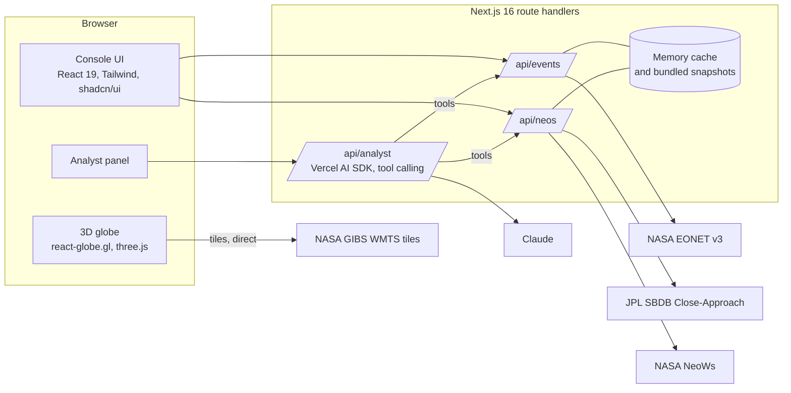

# Sentinel Earth

Live NASA data on fires, storms and passing asteroids, on one 3D globe, with an AI analyst that answers questions from the same feeds.

Built for the NASA Space Apps Challenge 2026.


## The problem

NASA publishes what is happening to the planet through many separate services: one for natural events, one for satellite imagery, others for near-Earth objects. A disaster analyst who wants to see a wildfire, the satellite pass that imaged it and how it developed over the past weeks has to work across several tools and formats.

Sentinel Earth joins four of those services in one view:

- **Natural events.** Every open event from NASA EONET for the last 30 days, on the globe and in a filterable list. Moving events such as storms and icebergs show their track.
- **Satellite imagery over time.** Five NASA GIBS layers (true color, fire and burn scars, sea surface temperature, city lights, Blue Marble) with a 30-day date slider and playback.
- **Asteroid passes.** Every object passing within 0.05 AU in the next 30 days from JPL, charted by date and miss distance and shown around Earth.
- **Analyst.** Ask a question in plain language. Claude queries the same feeds through tools, and every event it cites becomes a button that flies the globe there.
- **Shareable links.** The address always holds the layer, date and selected event, so a briefing can open on an exact view.

## Who it is for

NASA Earth Applied Sciences and Disasters program staff, the emergency managers they support, and anyone briefing non-specialists.

## Challenge alignment

> **To fill in before submitting.** The official 2026 challenge list could not be read automatically while this was built. Pick the challenge on <https://www.spaceappschallenge.org/2026/challenges/> that best matches Earth observation, disasters or open-data visualization, and name it here.

## Architecture



- The server normalises each feed into a small typed shape ([src/lib/nasa.ts](src/lib/nasa.ts)) and caches it in memory (events 10 minutes, asteroids 1 hour).
- If a NASA service fails, the server returns its last good answer, or the snapshot bundled in [src/data](src/data), and marks it as saved data. The interface says so. The demo never shows an empty screen.
- Imagery tiles load straight from GIBS in the browser; GIBS allows cross-origin requests.
- The analyst has two tools, `get_natural_events` and `get_close_approaches`, which read the same cached feeds as the interface. It is told to answer only from tool results and to cite event ids.

## Data sources

| Source | Used for |
| --- | --- |
| [NASA EONET v3](https://eonet.gsfc.nasa.gov/docs/v3) | Open natural events, positions, tracks, magnitudes |
| [NASA GIBS](https://www.earthdata.nasa.gov/engage/open-data-services-software/earthdata-developer-portal/gibs-api) | Daily imagery: MODIS Terra true color and bands 7-2-1, GHRSST sea surface temperature, VIIRS Black Marble, Blue Marble |
| [JPL SBDB Close-Approach API](https://ssd-api.jpl.nasa.gov/doc/cad.html) | Asteroid pass dates, distances, speeds, brightness |
| [NASA NeoWs](https://api.nasa.gov/) | Catalogued asteroid sizes and the potentially-hazardous flag |

## Setup

Needs Node.js 20.9 or newer.

```bash
npm install
cp .env.example .env.local   # then fill in the keys
npm run dev                  # http://localhost:3000
```

| Variable | Needed | Purpose |
| --- | --- | --- |
| `ANTHROPIC_API_KEY` | For the analyst | Without it the analyst panel reports that it is offline; everything else works. |
| `NASA_API_KEY` | Optional | Free from <https://api.nasa.gov>. Without it NeoWs uses the shared `DEMO_KEY`, which is rate limited. |
| `ANALYST_MODEL` | Optional | Defaults to `claude-opus-5-5`. |

### Checks

```bash
npm run build
npx next start -p 3210
npm run verify               # in a second terminal
```

`npm run verify` drives the app in Microsoft Edge at 1440px and 375px, saves screenshots to [docs/screenshots](docs/screenshots) and fails on any console error or failed request. Set `BROWSER_CHANNEL=chrome` to use Chrome. Set `ANTHROPIC_CHECK=1` to also wait for a live analyst answer.

### Deploy

```bash
npx vercel --prod
```

Add `ANTHROPIC_API_KEY` and `NASA_API_KEY` in the Vercel project settings first. The analyst route has no rate limit, so anyone with the URL can spend your API credits; add a limit before sharing the link widely.

## Two-minute demo script

1. **0:00 Open the app.** The camera falls in from deep space onto today's Terra imagery. "Everything here is live NASA data. Nothing is mocked."
2. **0:15 Events.** Point at the counts. Turn Wildfires off and on. Click a storm: the globe flies there and shows its track.
3. **0:35 Imagery over time.** Click "See that day's imagery". Switch the layer to "Fire and burn scars" on a wildfire. Press Play and let a few days run. "Thirty days of satellite passes, straight from GIBS."
4. **0:55 Share.** Click "Copy link" and open it in a new tab. Same event, same layer, same date.
5. **1:05 Asteroids.** Open the Asteroids tab. Read the closest pass from the chart against the Moon's distance line. Click "Show them around Earth".
6. **1:25 Analyst.** Ask: "Which active wildfires are near populated areas this week?" Click a citation in the answer and the globe flies to it. "The model can only answer from the feeds, and it shows its sources."
7. **1:50 Resilience.** "If NASA's service goes down mid-demo, the app serves its last saved data and tells you." Close on the About tab and the data sources.

## Known limits

- The "around Earth" asteroid view is a schematic. Distances are to log scale. Directions are placeholders, because the close-approach feed gives distance, not direction.
- Asteroid sizes marked "about" are estimated from brightness with an assumed albedo of 0.14.
- EONET positions are points. For events reported as polygons, the first vertex is used.
- There is no population layer. When asked about populated areas, the analyst reasons from coordinates and says it is an estimate.
- The server cache lives in memory, per instance.

Not an official NASA product.

## License

[MIT](LICENSE) © 2026 David Costache
